# Salsa Field Notes — Portofolio Interaktif

[](https://github.com/el-pablos/portofolio-salsa/actions/workflows/ci.yml)
[](https://portofolio-salsa.tams.codes)
[](https://github.com/el-pablos/portofolio-salsa)
[](https://github.com/el-pablos/portofolio-salsa)

## Deskripsi projek

Salsa Field Notes adalah portofolio interaktif milik **Adinda Salsa Aryadi Putri**. Situs ini bukan landing page generik dan bukan template resume yang hanya menumpuk kartu pengalaman. Bentuknya dibuat seperti papan catatan lapangan digital: pengunjung masuk lewat intro singkat, memilih jalur pada peta, lalu membuka area yang ingin dibaca. Setiap area punya karakter, tujuan, dan isi yang berbeda. Hasilnya tetap sebuah portofolio, tetapi cara membacanya terasa lebih dekat dengan zine editorial, peta permainan, dan buku catatan visual.

Isi situs bersumber dari materi portofolio Salsa yang sudah tersedia: pengalaman sosiologi, analisis data, riset sosial, visualisasi, proyek, sertifikat, desain, serta kanal kontak. Data di dalam `site/data/portfolio.json` dipakai sebagai satu sumber konten untuk render halaman. Dengan pendekatan ini, perubahan konten bisa dilakukan dari data tanpa mengulang markup di banyak tempat. Tidak ada proyek, gelar, angka kemampuan, klien, atau kontak yang dibuat-buat untuk mempercantik halaman.

Projek ini memakai HTML, CSS, dan JavaScript vanilla. Tidak ada backend, database runtime, akun pengguna, atau framework aplikasi yang wajib dijalankan di server. Vercel hanya menyajikan file statis dari folder `site/`. Interaksi seperti XP, filter archive, dialog, lightbox, dan preferensi reduced motion berjalan di browser pengunjung. `localStorage` hanya dipakai untuk menyimpan progres eksplorasi lokal; data pribadi tidak dikirim ke server.

Target deployment menggunakan Vercel Hobby dan domain custom `portofolio-salsa.tams.codes`. DNS subdomain diarahkan melalui Cloudflare ke `cname.vercel-dns.com`. Repository GitHub berada di akun `el-pablos` dengan nama `portofolio-salsa`. Konfigurasi root Vercel memakai folder `site` agar dokumentasi, test, screenshot, dan tooling tidak pernah menjadi payload website.

## Status dan prinsip kerja

- **Konten:** source-backed dari materi portofolio Salsa.
- **UI:** playful, editorial, berani, tetapi tetap bisa dibaca dan dinavigasi.
- **Responsif:** mobile-first untuk HP, tablet, laptop, dan desktop lebar.
- **Aksesibilitas:** dialog memakai focus trap, tombol punya label, Escape menutup dialog, dan warna dicek dengan audit aksesibilitas.
- **Keamanan:** token, `.env`, clone source lokal, evidence audit, cache, dan dependency runtime tidak diikutkan ke repository publik.
- **Deployment:** hanya folder `site/` yang menjadi payload Vercel.
- **Repository:** public di `github.com/el-pablos/portofolio-salsa`; tree publik sudah discan tanpa credential.
- **Dokumentasi:** README ini adalah dokumentasi utama repository. Screenshot UI disimpan di `docs/screenshots/` supaya gambar di README dapat dibaca langsung dari GitHub.

## Preview visual tiap halaman atau state

Situs ini menggunakan satu shell halaman dengan tujuh zone interaktif. Karena itu istilah “halaman” di dokumentasi berarti intro, peta, dan setiap dialog zone yang bisa dibuka pengunjung. Sembilan screenshot berikut diambil dari browser nyata pada build lokal yang sama dengan payload deployment, bukan gambar dummy.

### Intro

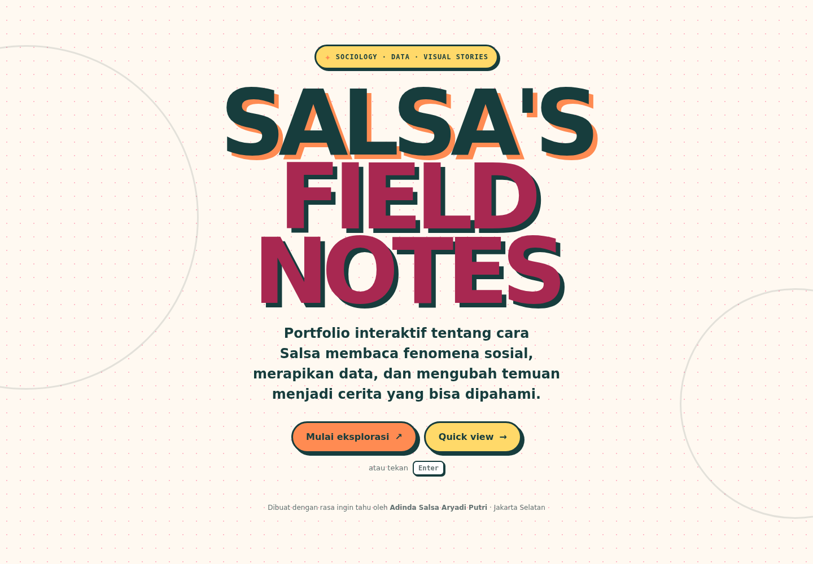

Halaman pertama memperkenalkan nama, konteks, dan dua pilihan aksi: mulai eksplorasi atau membaca quick view. Komposisinya sengaja tenang supaya pengunjung memahami konsep sebelum masuk ke peta.

### Map / Pilih Jalurmu

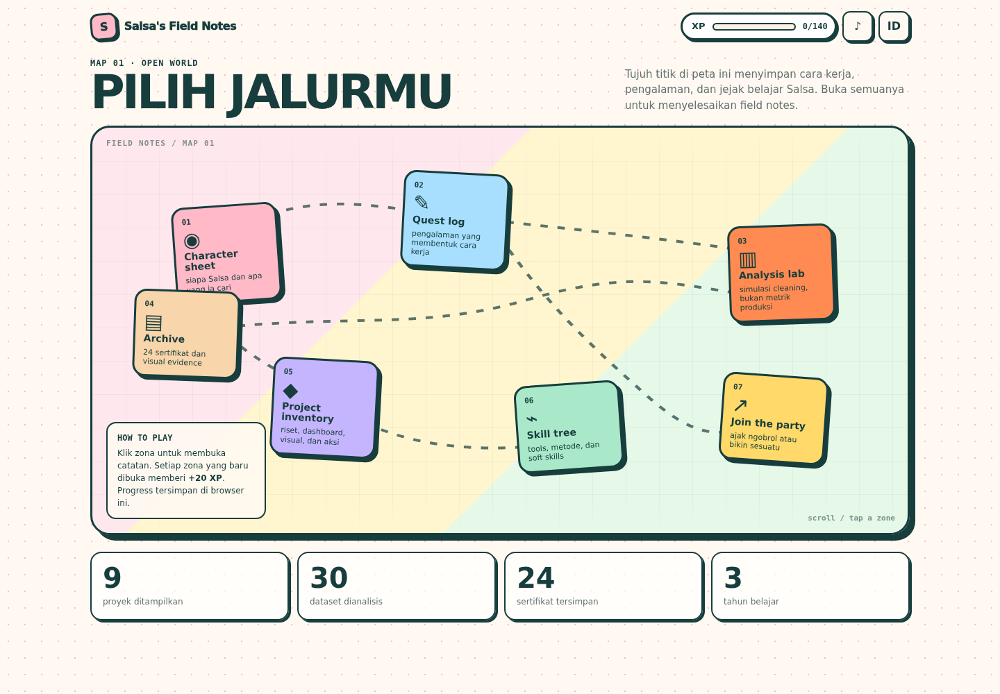

Map adalah pusat navigasi. Tujuh kartu zone membentuk jalur visual dengan relasi garis putus-putus. Pada desktop kartu memakai posisi editorial; pada mobile layout berubah menjadi grid sehingga tidak ada kartu yang keluar layar.

### Character Sheet

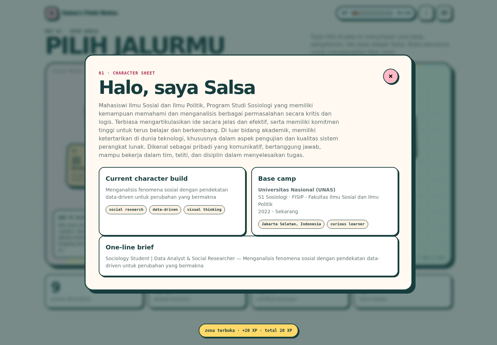

Area ini memuat ringkasan profil, current character build, base camp, dan one-line brief. Isinya menjawab siapa Salsa dan cara kerja yang ia bawa ke proyek.

### Quest Log

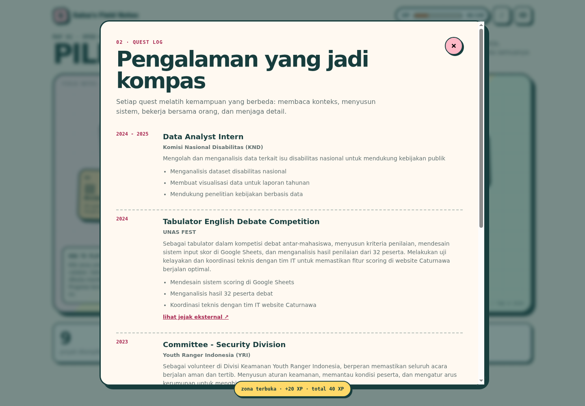

Quest Log berisi pengalaman yang sudah ada di source data, disusun sebagai kronologi ringkas dengan organisasi, peran, dan deskripsi tanggung jawab.

### Analysis Lab

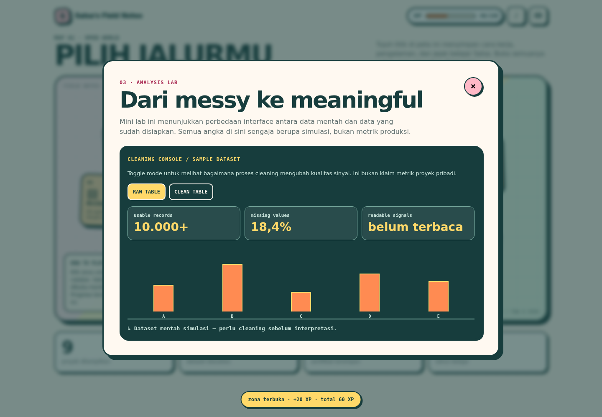

Analysis Lab menerjemahkan fokus analisis ke bentuk visual: statistik, tema, dan mini chart. Angka yang ditampilkan berasal dari data portfolio dan diberi konteks agar tidak terlihat seperti metrik tanpa arti.

### Certificate Archive

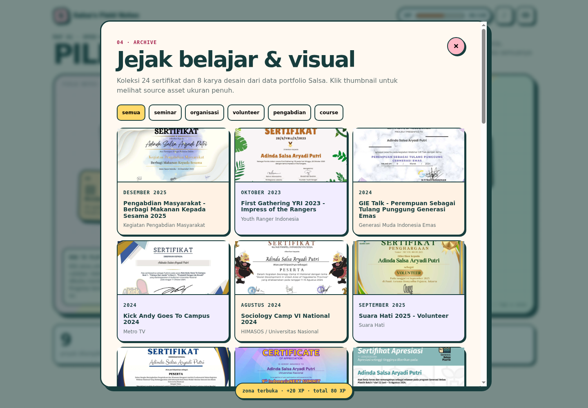

Archive menampilkan sertifikat dalam grid filterable. Pengunjung dapat memfilter berdasarkan kategori lalu membuka gambar dalam lightbox. Gambar dimuat secara lazy agar mobile tidak harus mengunduh seluruh arsip sekaligus.

### Project Inventory

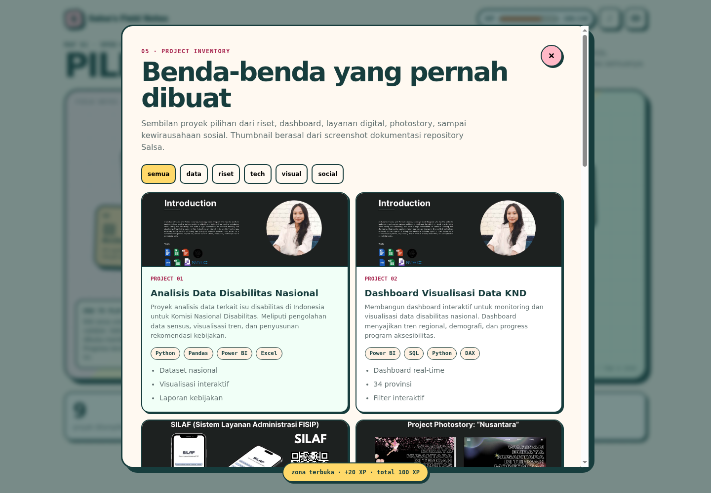

Inventory menampilkan benda-benda atau proyek yang pernah dibuat. Setiap kartu memakai visual source-backed dan deskripsi singkat, bukan gambar stok yang tidak berhubungan dengan pengalaman Salsa.

### Skill Tree

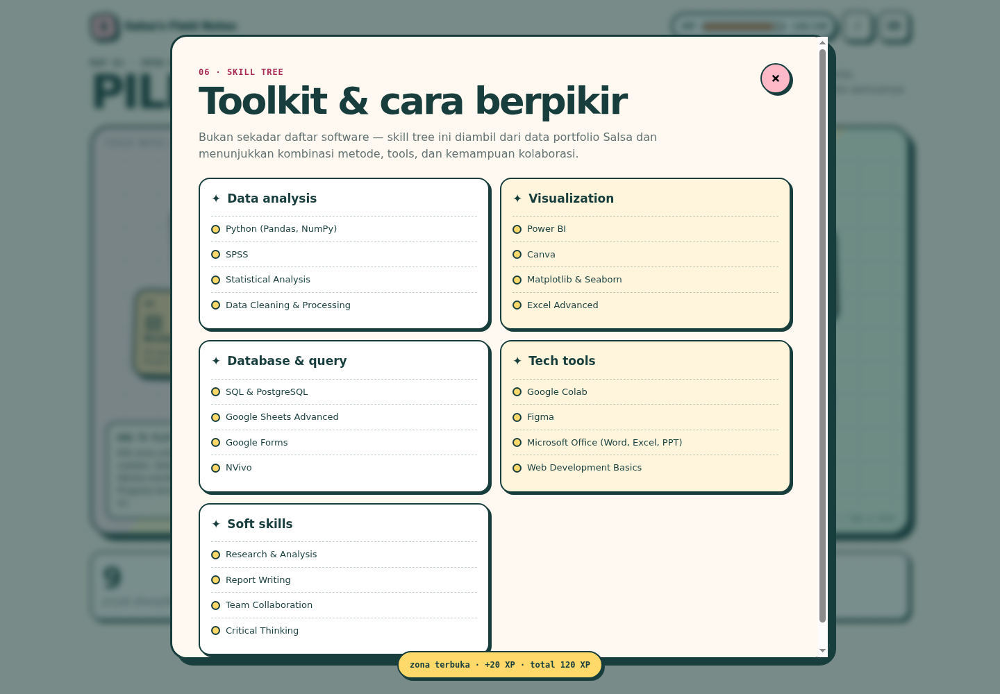

Skill Tree mengelompokkan kemampuan ke dalam data analysis, visualization, database and query, tech tools, serta soft skills. Tidak ada level numerik fiktif; struktur kategori dipakai untuk membantu pembaca memahami area kompetensi.

### Join the Party

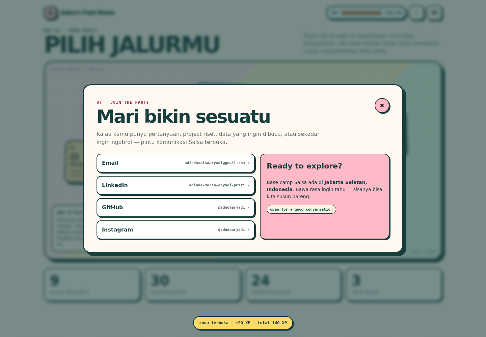

Area kontak berisi kanal yang memang tersedia di source data. Pengunjung dapat memilih kanal yang ingin dibuka. Tidak ada form backend yang mengumpulkan data secara diam-diam.

## Arsitektur projek

Arsitektur sengaja dibuat kecil, jelas, dan cocok untuk static hosting. `site/index.html` menjadi shell semantik. `site/styles.css` menangani visual system, responsive breakpoint, dialog, map, lightbox, focus state, safe area, dan reduced motion. `site/app.js` mengatur fetch data, render komponen, event delegation, navigasi zone, XP, filter, dialog, dan lightbox. Data konten tinggal di `site/data/portfolio.json`, sedangkan media dibagi berdasarkan fungsi.

```text
portofolio-salsa/
├── .github/
│   └── workflows/
│       └── ci.yml                 # quality gate setiap push dan pull request
├── docs/
│   └── screenshots/               # screenshot nyata untuk dokumentasi README
├── site/                          # satu-satunya payload deployment Vercel
│   ├── index.html                 # shell HTML dan struktur aksesibel
│   ├── styles.css                 # design system dan responsive layout
│   ├── app.js                     # render data dan interaksi browser
│   ├── vercel.json                # clean URL dan security headers
│   ├── data/
│   │   └── portfolio.json         # single source of content
│   └── assets/
│       ├── certificates/          # 36 file JPG teroptimasi
│       └── folio/                 # visual proyek dan design crop
├── tests/
│   ├── test_site.cjs              # behavior, data, asset, dan route-state test
│   └── security_scan.cjs          # scan credential dan file terlarang
├── package.json                   # script test dan metadata repository
├── package-lock.json              # dependency lock untuk CI reproducible
├── .gitignore                     # aturan secret dan file lokal
└── README.md                      # dokumentasi utama
```

Folder `source-salsa/`, `evidence/`, `tools/`, `.vercel/`, `.env`, `node_modules/`, cache Chromium, log, dan file audit lokal sengaja tidak menjadi bagian repository. Ini bukan berarti modul situs hilang. Folder tersebut adalah bahan kerja lokal atau dependency, sedangkan payload production sudah lengkap di `site/`.

### Alur data dan interaksi

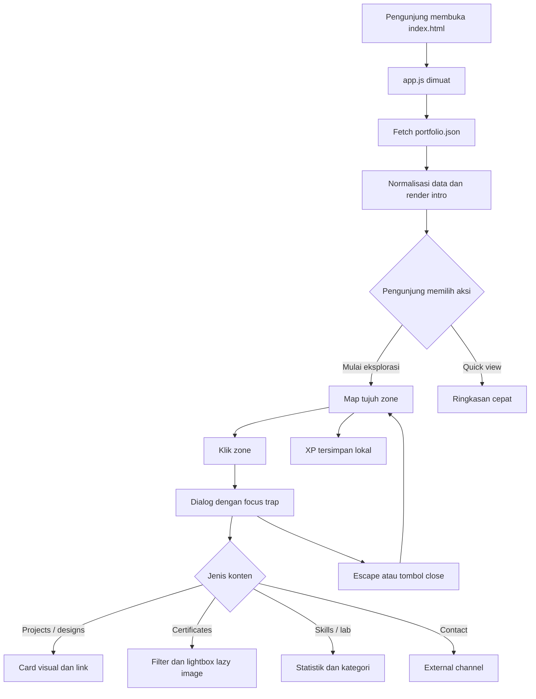

Tidak ada routing server-side. Semua state berada di satu halaman supaya deployment static tetap sederhana. “Route” di level UI adalah key zone: `about`, `experience`, `lab`, `archive`, `projects`, `skills`, dan `contact`. Test memeriksa ketujuh key ini supaya perubahan markup tidak diam-diam memutus salah satu jalur.

### ERD konseptual data portfolio

Walaupun tidak ada database runtime, bentuk relasi datanya dapat dipahami seperti ERD berikut. `portfolio.json` adalah dokumen agregat yang menghubungkan koleksi konten dengan asset path.

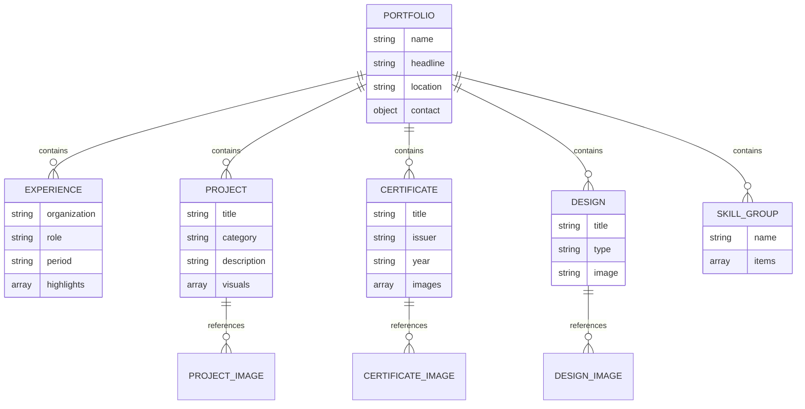

## Modul dan fitur yang diterapkan

### Intro dan quick view

Intro memberi orientasi awal, bukan splash screen yang menghalangi. Tombol utama menuju map, sedangkan quick view memberi jalur cepat bagi recruiter yang ingin langsung memahami profil. Focus ring terlihat pada navigasi keyboard. Tombol menggunakan teks yang jelas dan `aria-label` ketika ikon dipakai.

### Interactive map

Map menyatukan semua modul tanpa membuat navbar panjang. Desktop menggunakan posisi kartu yang terasa seperti papan investigasi. Pada breakpoint mobile, posisi absolute dilepas dan zone menjadi grid dua kolom atau satu kolom sesuai lebar viewport. Ini mencegah overflow horizontal, kartu tertindih, dan tap target yang terlalu kecil.

### Character Sheet dan Quest Log

Character Sheet merangkum profil dan positioning. Quest Log menampilkan pengalaman dalam urutan yang mudah dipindai. Kedua modul memiliki dialog terpisah sehingga layar utama tetap bersih. Isi keduanya berasal dari data experience/profile, bukan salinan yang dipelihara di banyak template.

### Analysis Lab

Analysis Lab memberi konteks pada cara Salsa membaca data dan isu sosial. Visualisasi dibuat sebagai elemen UI yang ringan, tidak bergantung pada library chart besar. Jika JavaScript gagal, struktur halaman tetap tersedia secara dasar dan tidak mengandung script inline berbahaya.

### Certificate Archive dan lightbox

Archive memiliki filter kategori dan gallery. File certificate yang besar dioptimalkan ke JPG agar request deployment tidak melewati batas Vercel. Mapping extension source ke file optimized ditangani oleh helper path, sehingga data source tetap dapat dibaca tanpa mengorbankan payload. Lightbox menunggu image benar-benar loaded, menyediakan tombol close, mendukung Escape, dan mengembalikan focus ke trigger.

### Project Inventory dan Skill Tree

Project Inventory menampilkan pekerjaan atau visual yang relevan. Skill Tree mengelompokkan kemampuan secara semantik, bukan memberi nilai level yang tidak punya bukti. Kedua modul berbagi pola card dan dialog, tetapi isi serta label tetap berbeda agar tidak terasa seperti komponen yang dipaksa sama.

### Contact / Join the Party

Join the Party mengarahkan pengunjung ke kanal yang tersedia. Link external memakai atribut yang aman dan tidak menyimpan input. Tidak ada tracking pihak ketiga atau form yang mengirim email tanpa penjelasan.

## Mobile-first dan aksesibilitas

CSS dimulai dari layout sempit lalu menambah kemampuan untuk viewport yang lebih besar. Breakpoint desktop tidak sekadar mengecilkan desain desktop; struktur map berubah agar sesuai dengan cara orang menyentuh layar. Safe-area inset dipakai pada elemen fixed yang dapat muncul dekat bagian bawah layar. Dialog memiliki area scroll sendiri supaya konten panjang tidak memaksa body menjadi sulit digerakkan.

Target interaksi dibuat nyaman disentuh. Tombol close tetap terlihat, chip filter memiliki padding yang cukup, dan focus state tidak dihapus hanya karena desain memakai warna cerah. `prefers-reduced-motion` dihormati dengan mengurangi transisi dan animasi. Warna teks dan panel diuji lewat audit aksesibilitas; hasil audit publik sebelumnya tidak menunjukkan serious atau critical violation.

## Keamanan dan hygiene repository

Tidak ada credential di README, source, asset, atau workflow. `.gitignore` menolak `.env`, `.env.*`, `.vercel`, `node_modules`, evidence lokal, clone source, cache, tools lokal, dan log. `tests/security_scan.cjs` memeriksa seluruh file yang tracked maupun untracked menurut Git, lalu menolak pola token provider, private key, bearer credential panjang, file `.env`, serta path lokal terlarang.

Vercel memakai header `X-Content-Type-Options: nosniff`, `X-Frame-Options: DENY`, `Referrer-Policy`, `Permissions-Policy`, dan Content Security Policy. CSP membatasi script dan koneksi ke origin sendiri; `unsafe-inline` hanya dipakai untuk style karena beberapa template dialog memakai inline layout kecil, bukan untuk script. Domain custom diarahkan dengan CNAME non-proxied supaya validasi Vercel tidak tertutup Cloudflare proxy.

Token yang pernah diberikan untuk setup tidak ditulis ke file, remote URL, commit, README, workflow, atau payload website. Untuk hygiene setelah pekerjaan selesai, token GitHub dan Cloudflare tetap sebaiknya di-rotate oleh pemilik akun karena token sempat dikirim melalui chat.

## Testing dan quality gate

Perintah utama yang harus lulus sebelum perubahan didorong ke `main`:

```bash
npm ci
npm run check
npm run security
npm audit --audit-level=high
```

`npm run check` menjalankan test behavior lalu `node --check site/app.js`. Behavior test mengecek data portfolio, jumlah koleksi, key zone, mapping certificate JPG, path asset, render dialog, filter archive, lightbox, keyboard Escape, focus, XP, dan tidak adanya secret marker. Security scanner berjalan terpisah agar kegagalan hygiene tidak tertutup oleh test UI.

GitHub Actions di `.github/workflows/ci.yml` berjalan pada Node.js 20 dan 22 untuk setiap push ke `main` serta pull request menuju `main`. Job memasang dependency dari lockfile, menjalankan behavior test, security scan, `npm audit`, dan whitespace check. Dengan matrix dua versi Node, masalah yang hanya muncul di satu runtime lebih mudah diketahui sebelum deployment.

Selain unit dan static test, build yang dipublikasikan telah diperiksa dengan browser CDP pada desktop dan mobile. Pemeriksaan mencakup tidak adanya horizontal overflow pada viewport 390px, semua zone dapat dibuka, image lightbox menunggu `naturalWidth`, keyboard Escape, focus dialog, asset response, dan axe audit. Screenshot README berasal dari sesi browser tersebut sehingga dokumentasi visual dan implementasi dapat dicross-check.

## Workflow GitHub ke Vercel

Alur yang diharapkan adalah:

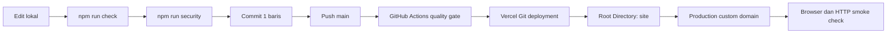

Repository ini tidak membawa token Vercel di GitHub Actions. Deployment Git memakai koneksi Git provider pada project Vercel dan pengaturan root directory `site`. Jika koneksi Git belum tampil di dashboard, owner repository perlu membuka Vercel Project Settings → Git → Connect Git Repository, memilih `el-pablos/portofolio-salsa`, lalu memastikan Root Directory tetap `site`. Setelah terhubung, push ke `main` menjadi production deployment dan branch lain menjadi preview deployment sesuai aturan Vercel.

Konfigurasi `site/vercel.json` menyediakan clean URL dan security headers. Karena root directory sudah diarahkan ke `site`, README dan tests tidak ikut disajikan sebagai website. Ini juga membuat payload lebih kecil dan menghindari kebocoran file audit lokal.

## Menjalankan lokal

Pastikan Node.js tersedia, lalu jalankan:

```bash
npm ci
npm run check
npm run security
python3 -m http.server 4173 --directory site
```

Buka `http://127.0.0.1:4173/`. Untuk QA visual, gunakan Chromium headless dengan remote debugging dan jalankan audit CDP yang tersedia di workspace lokal. Dependency browser dan evidence audit tidak diperlukan oleh website dan sengaja tidak masuk repository.

Jika hanya ingin melihat struktur tanpa server, buka `site/index.html`, tetapi fetch data lokal dapat dibatasi oleh aturan browser. Server HTTP sederhana lebih representatif terhadap kondisi Vercel.

## Statistik projek

- **7** zone interaktif utama.
- **9** project entry.
- **5** experience entry.
- **24** certificate entry.
- **8** design entry.
- **36** file certificate JPG teroptimasi.
- **55** file pada payload `site` saat dokumentasi ini dibuat.
- **9** screenshot state individual plus satu contact sheet.
- **2** versi Node pada matrix CI.
- **0** backend runtime.
- **0** database runtime.
- **0** credential pada payload publik.
- **1** README sebagai dokumentasi utama.

Angka di atas adalah snapshot build, bukan klaim performa sepanjang waktu. Jika data portfolio berubah, test dan statistik README perlu diperbarui bersamaan supaya dokumentasi tidak tertinggal dari source.

## Kontributor

- **Adinda Salsa Aryadi Putri** — pemilik portfolio, sumber konten, pengalaman, karya, dan kanal kontak.
- **Tamas / el-pablos** — implementasi repository, frontend, responsive pass, security hygiene, testing, deployment setup, dan dokumentasi.

Kontributor tambahan dipersilakan mengirim pull request yang menjelaskan konteks perubahan. Jangan mengunggah credential, screenshot yang memuat token, clone source privat, `node_modules`, atau file hasil audit yang tidak dibutuhkan oleh pengguna situs.

## Cara berkontribusi

1. Fork atau buat branch dari `main`.
2. Jalankan `npm ci`.
3. Ubah data atau UI dengan tetap menjaga provenance konten.
4. Jalankan `npm run check`, `npm run security`, dan `npm audit --audit-level=high`.
5. Periksa viewport mobile, tablet, dan desktop.
6. Pastikan dialog, lightbox, filter, Escape, dan focus tetap bekerja.
7. Tulis commit satu baris dengan format kasual-profesional, misalnya `fix: rapikan dialog archive di layar kecil`.
8. Buka pull request dengan screenshot jika perubahan visual.

Perubahan konten sebaiknya masuk ke `site/data/portfolio.json`. Perubahan visual masuk ke `site/styles.css`. Perubahan interaksi masuk ke `site/app.js` dan harus menambah atau memperbarui assertion test yang relevan. Jangan menambal hasil build secara manual di luar struktur source karena hal itu membuat audit berikutnya sulit direproduksi.

## Catatan desain

Referensi visual eksternal hanya dipakai sebagai inspirasi prinsip: hierarki editorial, peta interaktif, warna kontras, kartu yang sedikit playful, dan eksplorasi berbasis dialog. Source code, asset proprietary, copywriting privat, dan struktur internal website pihak lain tidak disalin. Identitas visual akhir dibangun dari konten Salsa sendiri, palette sendiri, dan ilustrasi atau crop yang berasal dari materi portfolio Salsa.

Keputusan desain utama adalah menyeimbangkan rasa bermain dengan keterbacaan. Heading besar memberi energi, tetapi body text tetap diberi lebar baca yang wajar. Dekorasi dotted dan garis map memberi konteks tanpa mengambil alih informasi. Dialog digunakan untuk menjaga peta tetap fokus, bukan untuk menyembunyikan konten penting. Di mobile, semua dekorasi tunduk pada ruang dan tap target.

## Penutup

Salsa Field Notes dibuat untuk memperlihatkan cara berpikir, pengalaman, dan karya Salsa lewat pengalaman yang lebih berkarakter daripada CV online biasa. Struktur static membuatnya murah dan mudah dipelihara, sedangkan test, security scan, CI, screenshot, dan dokumentasi membuat perubahan tetap bisa diverifikasi. Kalau konten bertambah, pola yang paling aman adalah menambah data source-backed, asset yang jelas asalnya, assertion test, screenshot state, lalu commit singkat yang menjelaskan perubahan.
